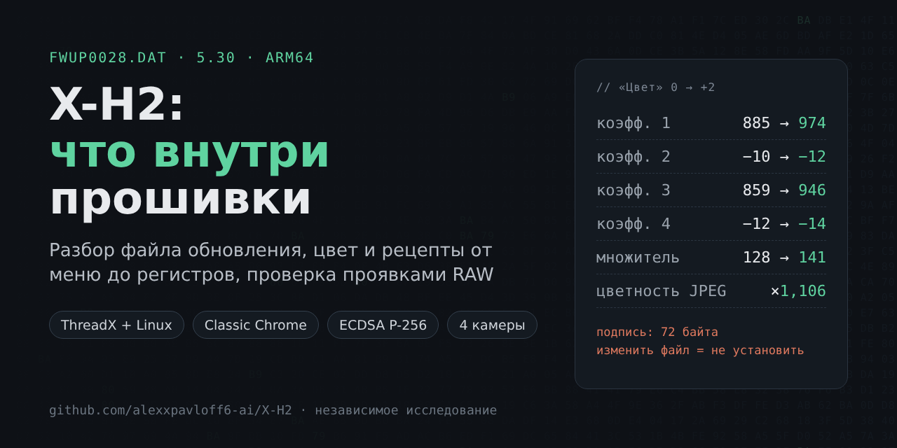

# Fujifilm X-H2: что внутри прошивки

**Тема:** как устроена прошивка Fujifilm X-H2 5.30, как камера превращает настройки рецепта в числа и можно ли её «доработать».
**Период работы:** с 30 октября 2026 г., репозиторий пополняется.
**Как собирали:** разбор файлов обновления X-H2, X-H2S, X-T5 и X100VI на компьютере, исполнение отдельных участков их кода в эмуляторе, проявки RAW в самой камере и измерение готовых JPEG. Исследование ведёт владелец X-H2 вместе с ИИ-ассистентом Claude (Anthropic).

Камера при этом не вскрывалась и не перепрошивалась, а файлы прошивки открывались только для чтения.

---

## Главный вывод

Прошивку X-H2 можно прочитать, но нельзя переписать. Файл обновления лишь слегка замаскирован и сжат, внутри видны две операционные системы (ThreadX и Linux), сотни задач камеры и таблицы настроек. Но в конце файла стоит цифровая подпись ECDSA P-256, и изменённый файл камера не примет.

Рецепты плёнок прошивку не меняют. «Цвет +2» — это другая строка таблицы и четыре пересчитанных коэффициента для тех же команд: 885 → 974, −10 → −12, 859 → 946, −12 → −14. На фотографиях эффект виден и измерим.

Чего мы пока не знаем: как считается автофокус и что именно меняет режим Boost. Это следующий этап, для него нужны опыты с камерой.

---

## Статьи простым языком

| № | Статья | О чём |
|---|---|---|
| 1 | [Что лежит в файле обновления](статьи/01_Что_лежит_в_файле_обновления.md) | Маскировка, сжатие, процессор ARM64, следы языка C |
| 2 | [Две операционные системы в одной камере](статьи/02_Две_операционные_системы_в_одной_камере.md) | ThreadX главная, Linux для связи; кто за что отвечает |
| 3 | [Почему свою прошивку не поставить](статьи/03_Почему_свою_прошивку_не_поставить.md) | Подпись, риск «кирпича», законные способы кастомизации |
| 4 | [Как «Цвет +2» становится числами](статьи/04_Как_Цвет_плюс2_становится_числами.md) | Путь от пункта меню до регистров обработчика изображения |
| 5 | [Что такое рецепт на самом деле](статьи/05_Что_такое_рецепт_на_самом_деле.md) | Три уровня рецепта, коды настроек, что пишется в EXIF |
| 6 | [Проверка фотографиями](статьи/06_Проверка_фотографиями.md) | Один RAW, двадцать проявок в камере, что измерили |
| 7 | [Четыре камеры, одна семья](статьи/07_Четыре_камеры_одна_семья.md) | X-H2, X-H2S, X-T5, X100VI: общее и различия |
| 8 | [Автофокус, Boost и белые пятна](статьи/08_Автофокус_Boost_и_белые_пятна.md) | Что нашли про фокус и производительность и чего не знаем |
| 9 | [Как мы работали и где ошибались](статьи/09_Как_мы_работали_и_где_ошибались.md) | Правила, уровни доказательств, исправленные ошибки |

PDF-версия всех статей одним файлом: [pdf/X-H2_прошивка_статьи.pdf](pdf/X-H2_прошивка_статьи.pdf).

## Полные отчёты

Папка [полные_отчёты](полные_отчёты/) содержит все рабочие отчёты без сокращений (более ста), сценарии на Python и машинные результаты в JSON. Язык там технический. Удобные точки входа:

- [Описание прошивки X-H2 5.30](полные_отчёты/Описание_прошивки_X-H2_5.30.md)
- [Предварительный итог и план](полные_отчёты/Предварительный_итог_и_план.md)
- [Исследование без камеры: итог](полные_отчёты/Исследование_без_камеры/Итог.md)
- [Последовательное исследование: итог](полные_отчёты/Последовательное_исследование/Итог_исследования.md)
- [Сравнение четырёх камер](полные_отчёты/Сравнение_камер/Общий_разбор_четырёх_камер.md)
- [Слоты C1–C7, прочитанные с камеры по USB](полные_отчёты/Чтение_камеры_по_USB/Слоты_C1-C7.md)
- [Проявка RAW в камере по USB и карта профиля](полные_отчёты/Чтение_камеры_по_USB/Проявка_в_камере.md)
- [Настройки автофокуса по USB](полные_отчёты/Чтение_камеры_по_USB/Автофокус_по_USB.md)
- [Связь USB-исследований с прошивкой](полные_отчёты/Чтение_камеры_по_USB/Связь_USB_и_прошивки.md)
- [Что закрывают fujicli, rawji и fujinx](полные_отчёты/Внешние_инструменты/Отчёт.md)

Рабочий инструмент: [скрипт проявки RAW в камере по рецепту](скрипты/README.md).

Ход работы по датам — в [журнале](ЖУРНАЛ.md).

## Чего здесь нет и почему

| Не публикуется | Причина |
|---|---|
| Файлы прошивок `.DAT` | Собственность Fujifilm. Скачайте их с [официального сайта](https://www.fujifilm-x.com/global/support/download/firmware/cameras/x-h2/) |
| Дизассемблированный код, выгрузки строк и файлов из прошивки | Это фрагменты чужого кода и данных |
| Открытые ключи | Уже опубликованы проектом [fffw](https://github.com/tiredboffin/fffw), ссылки в отчётах |
| Фотографии разборки камеры, иллюстрации и логотипы Fujifilm | Чужие права на изображения и товарный знак |
| Сами снимки владельца, место и время съёмки | Личные данные |
| Бинарные библиотеки Unicorn и Capstone | Ставятся из их официальных источников |

Ссылки на такие файлы в отчётах заменены пометкой «файл не публикуется». Пути на компьютере владельца заменены заглушками вида `<корень проекта>`.

## Правовая оговорка

Это независимое исследование, Fujifilm в нём не участвует и его не одобряет. FUJIFILM, X-H2, Classic Chrome и другие названия — товарные знаки их владельцев. Материалы не призывают изменять прошивку камер: установка изменённого ПО может вывести камеру из строя и лишить гарантии. Тексты не являются юридической консультацией.

## Лицензия

Тексты статей и отчётов — [CC BY 4.0](LICENSE-TEXT.md). Сценарии на Python — [MIT](LICENSE). Лицензии не распространяются на упомянутые материалы третьих сторон.

## Как добавляется новый отчёт

Новый этап работы попадает в репозиторий по [шаблону](ШАБЛОН_ОТЧЁТА.md): полный отчёт в `полные_отчёты/`, при необходимости статья простым языком в `статьи/`, строка в [журнале](ЖУРНАЛ.md).
