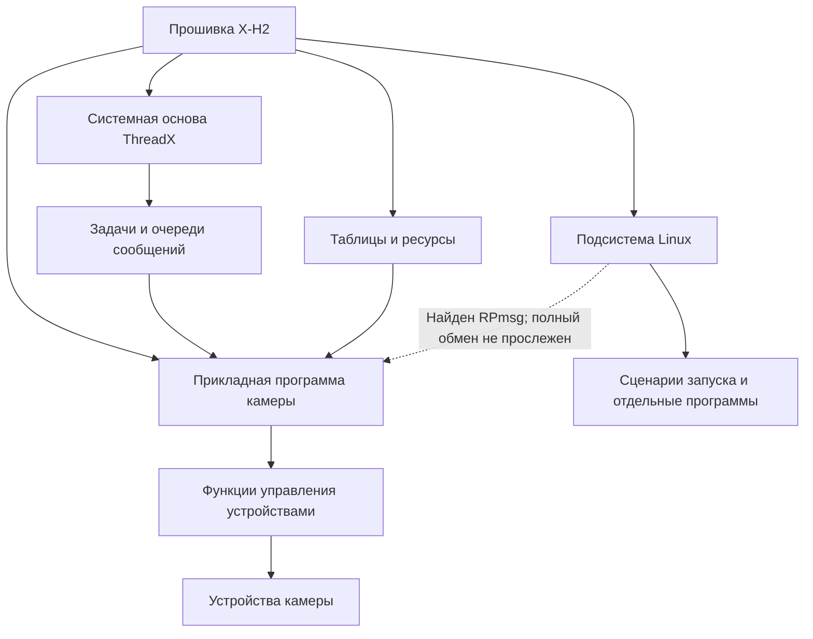
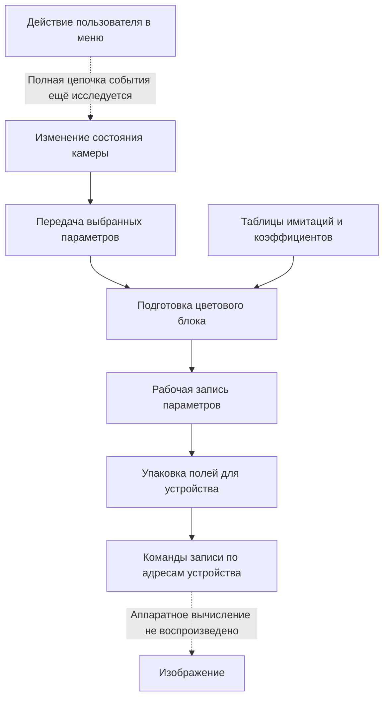
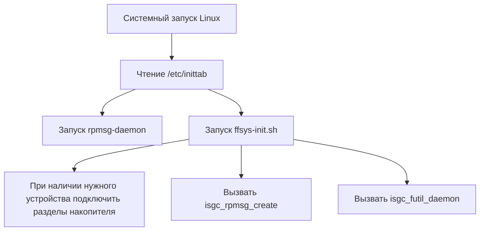
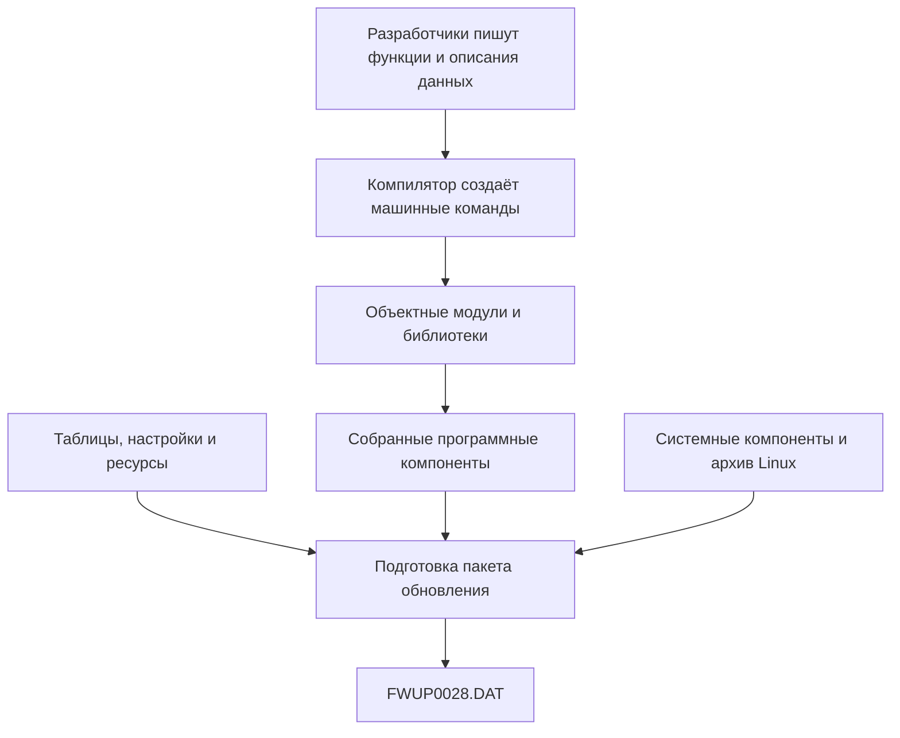

# Из каких частей состоит прошивка Fujifilm X-H2

Исследован предоставленный FWUP0028.DAT версии 5.30. Проверка от 1 ноября 2026 года.

## 1. Общая картина

Прошивка объединяет несколько программных компонентов и большие наборы данных. По найденным частям её устройство удобно представить как книгу с основным текстом, справочниками, иллюстрациями и приложениями. При работе камеры разные задачи обращаются к нужным разделам этой книги.

Внутри уже различимы четыре крупные составляющие:

1. **Системная основа ThreadX.** Подготовка процессора, выполнение задач, очереди сообщений и другие служебные действия. В системном модуле найдены название ThreadX и реальные команды создания очереди и задачи.
2. **Прикладная программа камеры.** Меню, настройки, управление съёмкой, фокусировка, подготовка изображения, запись и просмотр. По цвету некоторые цепочки проверены исполнением команд; по другим областям пока в основном найдены обозначения и точки входа.
3. **Подсистема Linux.** Найдены заголовок ядра, его параметры сборки, сжатый архив файловой системы, сценарии запуска и отдельные программы, включая сетевые компоненты Fujifilm.
4. **Данные и ресурсы.** Числовые таблицы, встроенный образ настроек, названия режимов, переводы надписей и материалы для изображения интерфейса. Нужная программа читает их во время работы.

Эти четыре составляющие не совпадают с четырьмя сжатыми областями FFLZ. В одном сжатом блоке находятся разные виды содержимого, а одна функциональная область может использовать данные из нескольких мест.



Схема показывает состав и роли. Она не закрепляет каждый блок за отдельным ядром процессора. На ней не утверждается, что вся обработка фотографии проходит через Linux.

## 2. Главные «главы» по назначению

Названия глав ниже даны для объяснения. Исходное оглавление проекта Fujifilm и его полный набор папок не восстановлены.

| Глава | Что делает | Что найдено в этом файле | Глубина подтверждения |
|---|---|---|---|
| 1. Запуск и системная организация | Подготовить процессор и рабочую среду; дать задачам время на выполнение | Команды установки адресов обработчиков исключений; строка ThreadX; создание `uiSYSQ` и `uiSYST`; образ Linux | Конкретные команды и структуры; полная загрузка камеры не воспроизведена |
| 2. Кнопки, меню и экран | Принять действие, выбрать пункт, показать результат | `KEY_FOCUS_AF`, `UI_MENUCOM_ITEM_FILM_SIM`; многочисленные строки интерфейса; обозначения отрисовки и работы со шрифтом | Названия и ресурсы, отдельные обработчики; весь путь от физической кнопки не прослежен |
| 3. Состояние камеры и настройки | Хранить выбранные режимы и передавать их следующим частям | Таблицы соответствия кодов; функции работы с параметрами; поля рабочих записей | Некоторые преобразования и переносы проверены исполнением |
| 4. Управление съёмкой и фокусировка | Организовать съёмку и работу фокусировки | `A_REC_MOVIE`, `MODE_FOCUS_CAF_ZONE`, обозначения режимов AF/MF | Названия и участки программы; полный алгоритм автофокуса не восстановлен |
| 5. Подготовка изображения | Выбрать цветовые и тональные параметры; подготовить задания обработчикам | Коэффициенты Classic Chrome, регулировка «Цвет», 40 тональных значений, HDR-параметры | Несколько цепочек исполнены; полное преобразование RAW в JPEG ещё не восстановлено |
| 6. Запись, просмотр и сведения о кадре | Формировать и сохранять результат, учитывать параметры кадра | Структуры описания кадра, ветви записи и просмотра, преобразование кода FilmMode | Отдельные поля и преобразования проверены; весь путь записи файла не исследован |
| 7. Связь и передача файлов | Работать с беспроводной связью и внешними службами | Linux-программы `ff_ftp.exe`, `ff_frameio.exe`, сетевые средства, библиотека `libff_api.a` | Файлы реально извлечены в памяти и разобраны; их фактическое включение в каждом режиме камеры не проверено |
| 8. Работа с устройствами | Превращать рабочие параметры в записи, понятные устройствам | Дерево устройств; таблицы адресов; команды упаковки и низкоуровневой записи | Для выбранной цветовой группы путь до записи по адресам устройства проверен в виртуальной памяти |
| 9. Справочники и оформление | Дать программам числа и надписи для выбранного режима | Образ настроек, таблицы адресов и коэффициентов, тексты ресурсов | Часть таблиц точно извлечена; полная карта всех графических ресурсов не построена |

Слова «меню», «фокусировка» и «цвет» обозначают здесь области ответственности. Их нельзя считать тремя независимыми файлами, которые уже найдены и могут быть заменены по отдельности.

## 3. Как части связаны между собой

Пример «выбрать Classic Chrome и изменить Цвет» показывает несколько разных обязанностей:



Для этой схемы проверены согласованные участки передачи и расчёта параметров. Они выполнялись отдельно с заданными входами. Это не единый запуск всей камеры от нажатия кнопки до получения снимка.

Важное различие между блоками:

- **Меню** определяет, что выбрано.
- **Хранилище состояния** держит выбранное значение.
- **Таблица** задаёт, какие числа относятся к этому варианту.
- **Функция расчёта** пересчитывает числа с учётом других условий.
- **Функция упаковки** размещает результаты в полях нужной ширины.
- **Низкоуровневая функция** записывает подготовленные слова по адресам устройства.

Поэтому замена надписи «Classic Chrome» не заменит её цветовое преобразование: надпись и математические параметры находятся на разных уровнях программы.

## 4. Как устроено выполнение кода

### Функции: отдельные действия

Функция – участок команд, которому передают входные значения и который выполняет определённую работу. Например, одна функция переводит код настройки в другое представление, другая читает таблицу, третья умножает коэффициенты.

Команда вызова связывает функции друг с другом. В уже исследованном цветном примере функция `0x02F27054` вызывает подготовку небольшого пакета, а затем переносит его поля в общую запись. Это похоже на абзац, который поручает два действия другим абзацам.

### Рабочие записи: карточки с полями

Связанные параметры хранятся рядом в памяти. Такая запись может содержать код имитации, значение «Цвет» и другие поля. Обращение `+0x39B8` означает расстояние от начала определённой записи до нужного поля.

Обозначения P, T и C в прежних материалах были нашими краткими именами разных рабочих записей. Восстановленными названиями переменных Fujifilm они не являются.

### Таблицы: выбор правил по числу

Вместо отдельного большого алгоритма для каждого пункта меню код может выбирать строку таблицы. Уже проверено, что Classic Chrome проходит через разные числовые представления: код режима 13, код цветового блока 8, номер набора коэффициентов 6. Каждый номер относится к своему справочнику.

### Задачи и очереди: поручения между частями программы

В системном модуле найдены очередь **uiSYSQ** и задача **uiSYST**. В исследованном механизме сообщение состоит из двух 32-разрядных слов:

```text
Слово 1: адрес функции, которую нужно вызвать.
Слово 2: значение, которое нужно передать этой функции.
```

Реальные команды обработчика:

```asm
00055F94  BL   #0x00043240
00055F98  CBNZ w0, #0x00055F84
00055F9C  LDR  w1, [sp, #0x38]
00055FA0  LDR  w0, [sp, #0x3C]
00055FA4  BLR  x1
00055FA8  B    #0x00055F84
```

Смысл: получить сообщение; при успешном получении взять адрес функции и передаваемое значение; вызвать функцию; вернуться к ожиданию следующего сообщения.

Подготовка отправляемых двух слов и подготовка аргументов вызова после получения отдельно проверены исполнением исходных команд в виртуальной памяти. В опыте использовались искусственный адрес `0x12345678` и число 42. Сам вызов по этому адресу не выполнялся. Это подтверждает устройство конкретного механизма; не установлено, что каждое действие меню или каждая цветовая настройка проходит именно через эту очередь.

В общем устройстве ThreadX задачи и очереди – штатные средства организации работы. Здесь они подтверждаются также местными командами и именами, а не только описанием операционной системы. [Документация ThreadX о компонентах системы](https://github.com/eclipse-threadx/rtos-docs/blob/main/rtos-docs/threadx/chapter3.md).

## 5. Подсистема Linux: найдены настоящие файлы и сценарии

Новый результат этой проверки – распакован в памяти архив файловой системы Linux. В сжатом виде он занимает **20 303 387 байт**, после распаковки – **50 071 552 байта**.

В архиве **3 202 записи**, без завершающей служебной записи:

| Вид | Количество |
|---|---:|
| Обычные файлы | 2 355 |
| Каталоги | 181 |
| Символические ссылки | 604 |
| Записи символьных устройств | 30 |
| Записи блочных устройств | 32 |

Это не 3 202 написанные Fujifilm программы. В состав входят системные средства, библиотеки, настройки, ссылки и другие материалы.

Среди реальных путей:

```text
/sbin/init
/etc/inittab
/etc/init.d/ffsys-init.sh
/etc/init.d/rpmsg-daemon
/etc/rpmsg-daemon.conf
/usr/bin/rpmsg-daemon
/usr/lib/libff_api.a
/usr/local/bin/fujifilm/ff_ftp.exe
/usr/local/bin/fujifilm/ff_frameio.exe
/usr/local/bin/fujifilm/ff_c2pa.exe
```

Расширение `.exe` в этих примерах не означает программу Windows: у трёх перечисленных программ проверены заголовки ELF64 с кодом архитектуры AArch64.

В `/etc/inittab` действительно записаны строки:

```text
null::sysinit:/usr/bin/rpmsg-daemon
null::sysinit:/etc/init.d/ffsys-init.sh
```

Они предписывают при системном запуске вызвать две указанные программы. Сценарий `ffsys-init.sh` содержит, в частности, такие действия:

```sh
if [ -e /dev/mmcblk0p3 ]; then
mount /dev/mmcblk0p1 /mnt/update
mount /dev/mmcblk0p2 /mnt/usr
mount /dev/mmcblk0p3 /mnt/tmp
fi

/usr/bin/isgc_rpmsg_create
/usr/bin/isgc_futil_daemon -i 1
```

Это подлинный фрагмент текста внутри прошивки, а не восстановленный пример C. Он описывает подключение разделов встроенного накопителя при указанном условии и запуск двух служебных программ. Здесь приведена цитата для разбора; этот сценарий на компьютере не запускался.



Схема передаёт предписания сценариев. Фактическая загрузка Linux на физической камере в этой работе не наблюдалась.

В параметрах сборки ядра найдены `CONFIG_RPMSG=y` и связанные варианты, а в настройке служебной программы указан `/dev/rpmsg_ctrl0`. RPmsg предназначен для обмена сообщениями с другими процессорными компонентами. Это подтверждает наличие соответствующих средств в образе. Полный протокол и распределение обязанностей между Linux, ThreadX и остальными частями X-H2 пока не восстановлены. [Документация Linux о RPmsg](https://docs.kernel.org/staging/rpmsg.html).

Наличие сетевых компонентов позволяет отнести часть Linux-окружения к задачам связи. Оно не доказывает, что Linux отвечает только за связь или что наличие файла означает его постоянное выполнение.

## 6. На каких языках и из каких модулей написаны части

Теперь для одного небольшого участка известны настоящие имена исходных файлов. В библиотеке **`/usr/lib/libff_api.a`** находятся пять объектных модулей:

| Имя исходного файла в таблице символов | Объектный модуль | Найдено определённых глобальных функций |
|---|---|---:|
| wlan_wld_api.c | wlan_wld_api.o | 69 |
| ff_wlan_api.c | ff_wlan_api.o | 28 |
| wpa_ctrl.c | wpa_ctrl.o | 9 |
| os_unix.c | os_unix.o | 4 |
| common.c | common.o | 3 |
| **Всего в этой библиотеке** | **5 модулей** | **113** |

Эти имена действительно присутствуют в таблицах символов объектных файлов. Во всех пяти найдены отладочные разделы и сведения о GCC 7.3.0. Это конкретное подтверждение компонентов на C.

113 – число перечисленных определённых глобальных функций в данной библиотеке. Это не число всех функций прошивки, не число строк C и не полный объём сетевого кода.

Примеры настоящих имён функций: `WLD_ssStaScan`, `WLD_ssScanResults`, `WLD_ssSetCountry`, `wpa_ctrl_open`, `wpa_ctrl_close`. По именам видны обязанности, связанные с беспроводной связью. Полные тела этих функций и их участие в каждом режиме камеры в настоящем разборе не восстанавливались.

Устройство найденной библиотеки:


Первые две формы связаны по таблицам символов. Точные команды сборки Fujifilm не найдены. Наличие библиотеки в файловой системе не устанавливает, какая конкретно программа и когда использует каждую её функцию.

В Linux-окружении также есть `libstdc++.so.6`. У программы `rpmsg-daemon` найдены ссылки на `libstdc++.so.6` и `CXXABI_1.3`, то есть связь с поддержкой C++. Полное происхождение её исходных файлов отдельно не исследовано.

Итак, в разных местах обнаружены:

- **C:** настоящие имена пяти исходных файлов и соответствующие объектные модули; также прежние упоминания других файлов `.c`.
- **C++:** библиотека поддержки и ссылки на неё из одной программы Linux.
- **Сценарии командной оболочки:** читаемый текст файлов `.sh` и сценариев запуска.
- **Настройки и ресурсы:** текстовые записи, числовые таблицы и двоичные данные, которые сами по себе не являются командами процессора.
- **ARM64:** язык готовых машинных команд исследованных программных частей.

Нельзя достоверно приписать всей фирменной обработке изображения один исходный язык. При этом прежнее общее утверждение «никакого исходного текста нет» следует уточнить: исходные тексты основных фирменных алгоритмов C/C++ не получены, но читаемые сценарии запуска внутри Linux есть.

## 7. Как из написанного кода получается файл прошивки

Обычный смысл процесса сборки таков:



Найденные `.o`, `.a`, ELF-файлы, сценарии и сжатые области подтверждают наличие соответствующих форм содержимого. Полный сценарий сборки всего DAT, исходный проект и точная последовательность его упаковки не восстановлены. Поэтому схема объясняет отношения между формами программы, а не выдаёт готовую команду сборки Fujifilm.

Установку обновления нужно отличать от повседневной работы. Установка переносит программные компоненты и данные в камеру. Во время съёмки процессор выполняет команды и меняет рабочие записи в памяти. Изменение настройки «Цвет» не требует заново собирать DAT.

## 8. Где расположены найденные части в файле

Размер исходного файла – **110 302 544 байта**. Ниже приведены установленные места, а не полная таблица всех разделов пакета.

| Смещение от начала DAT | Содержимое | Что известно |
|---|---|---|
| 0x00000204 и 0x00000208 | Поля версии | Значения 0x05 и 0x30 задают версию 5.30 в принятом представлении |
| 0x00060274 | Малый системный модуль | Заголовок с адресом 0x00040000; строка ThreadX; очередь и системная задача |
| 0x000C0274 | Базовый образ настроек | 814 080 байт; содержит, в частности, извлечённые цветовые числа |
| 0x00300274 | Сжатая область FFLZ I | 12 042 160 байт после распаковки; смешанные команды, данные и обозначения |
| 0x00840274 | Сжатая область FFLZ II | 15 515 648 байт после распаковки; в ней находятся исследованные цветовые ветви |
| 0x00F40274 | Сжатая область FFLZ III | 14 876 672 байта после распаковки; среди признаков – обозначения отрисовки интерфейса |
| 0x024A0274 | Сжатая область FFLZ IV | 7 394 632 байта после распаковки; многочисленные записи с сигнатурой GVFF, полный формат не разобран |
| 0x03C40274 | Дерево устройств | 11 425 байт; сведения о совместимости и устройствах |
| 0x03CB0274 | Начало образа ядра Linux | Корректный заголовок AArch64 Linux Image; версия 4.9.92 подтверждена строкой и настройками сборки |
| 0x04137274 | vDSO внутри Linux-компонента | ELF64 с именем linux-vdso.so.1 и функциями времени; не отдельная основная программа камеры |
| 0x0413B474 | Сжатые параметры сборки Linux | После распаковки 60 354 байта текста |
| 0x042DFDCC | Сжатая файловая система Linux | 20 303 387 байт сжатого потока; 3 202 записи после разбора |
| 0x06931508 | Цифровая подпись | 72 байта; подпись исходного файла ранее проверена |

Содержимое большинства рассматриваемых областей сначала восстанавливается инверсией битов. FFLZ и gzip – дополнительные способы сжатия разных компонентов. Смещение внутри распакованной области нельзя просто прибавить к её началу в DAT, чтобы получить место тех же данных в сжатом файле.

Заголовок Linux проверен по официальному описанию: у него есть 64-разрядные поля смещения и эффективного размера образа и сигнатура `0x644D5241`. Поле эффективного размера здесь равно 27 521 024 байтам. Оно описывает требования образа к памяти и само по себе не является доказанной границей отдельного раздела DAT. [Формат заголовка AArch64 Linux Image](https://docs.kernel.org/arch/arm64/booting.html).

Уточнение про vDSO согласуется с исходным правилом сборки Linux 4.9, где указан `linux-vdso.so.1`. [Правило сборки vDSO Linux 4.9](https://raw.githubusercontent.com/torvalds/linux/v4.9/arch/arm64/kernel/vdso/Makefile).

## 9. Что установлено и чего пока нельзя утверждать

**Установлено по содержимому:** несколько системных и прикладных компонентов; таблицы и ресурсы; системная очередь с вызовом функции из сообщения; образ Linux с файловой системой; пять реальных объектных модулей одной библиотеки с именами исходных файлов; отдельные проверенные цепочки работы с цветом.

**Пока не восстановлено:** всё дерево исходников; точное число всех программных модулей и функций; полный порядок загрузки; распределение всех задач по ядрам; все взаимодействия Linux и ThreadX; полный алгоритм фокусировки; вся последовательность обработки изображения до готовой фотографии.

Для практического изменения поведения камеры нужно находить конкретную связь: действие → состояние → вызываемые функции → используемые данные → работа устройства. Общая карта помогает выбрать эту связь, но не заменяет разбор нужной функции.

## 10. Проверяемые материалы

- Сведения и результаты проверки *(файл не публикуется)*.
- Полный перечень 3 202 записей Linux *(файл не публикуется)*.
- [Реальные имена 113 функций пяти объектных модулей](Модули_и_функции_библиотеки_связи.tsv).
- Машинные команды системной очереди и начала запуска *(файл не публикуется)*.
- [Программа повторной проверки](проверить_архитектуру.py).

Проверены контрольные суммы всех четырёх распакованных областей, завершение обоих потоков gzip, границы всех записей CPIO, структура библиотеки и заголовки выбранных ELF-файлов. Два фрагмента подготовки сообщений исполнены в виртуальной памяти. Файлы Linux, их сценарии и программы на компьютере не запускались.

SHA-256 исходного DAT до и после проверки:

`be47168cb075ef726e67cb4bb08175a896047a3b0de2bcb6e65333b22cfcb203`
