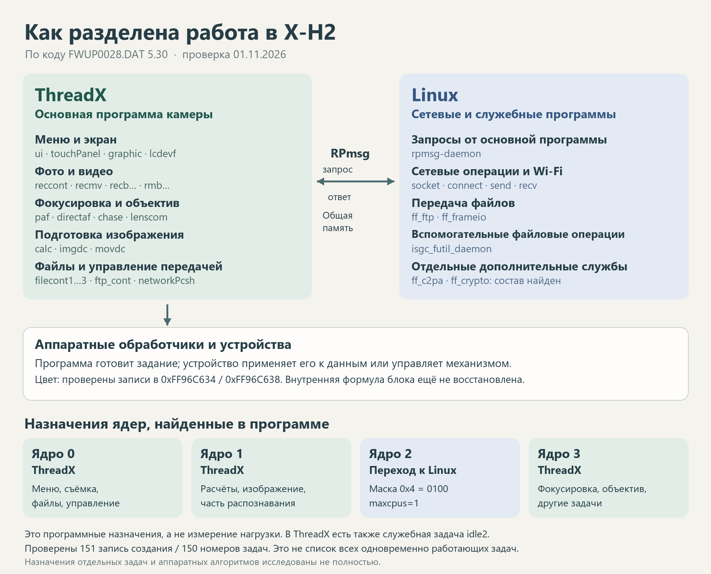
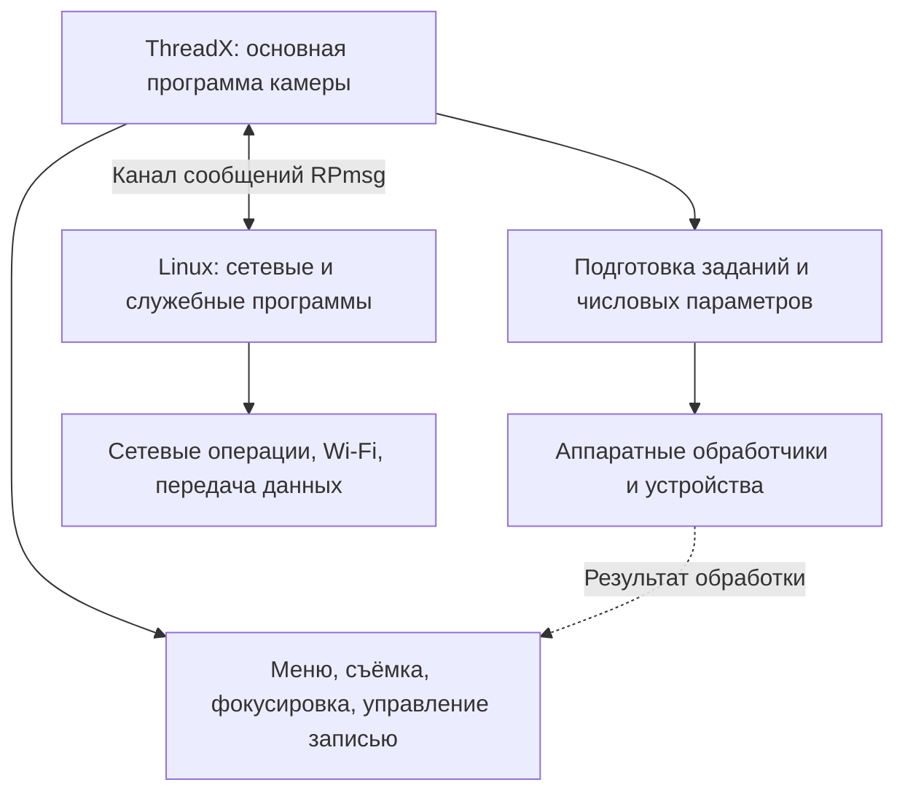
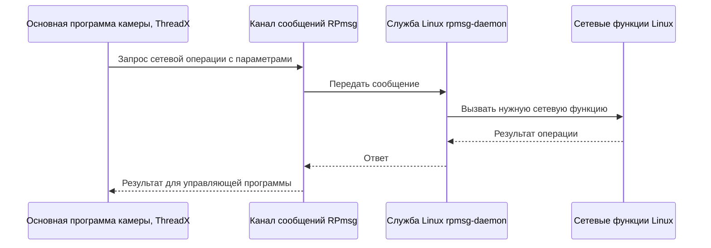
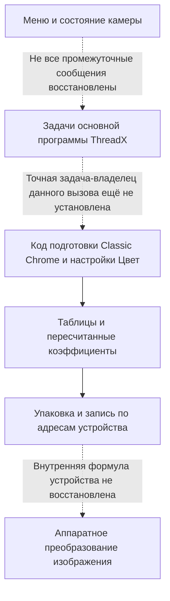

# Кто за что отвечает в прошивке Fujifilm X-H2

Исследован предоставленный файл **FWUP0028.DAT версии 5.30**. Проверка: 1 ноября 2026 года.

## 1. Ответ на вопрос о Linux

**В этой прошивке предусмотрены две операционные системы: ThreadX и Linux. Основная программа управления камерой организована вокруг ThreadX. Linux запускается отдельным путём и предоставляет сетевые и другие вспомогательные службы.**

Это заключение опирается на команды создания задач, назначения ядер и перехода к ядру Linux. Ранее были найдены преимущественно названия и состав файлов; теперь восстановлены конкретные связи между ними.

Точная формулировка для описания камеры:

> Программное обеспечение X-H2 имеет несколько взаимодействующих частей. ThreadX организует основные задачи камеры: управление, съёмку, работу фокусировки и подготовку изображения. Linux предоставляет сетевые и отдельные служебные функции. Вычислительные блоки процессора выполняют операции, которыми управляет программа.

Поэтому слова «в камере используется Linux» подтверждаются. Слова «всё программное обеспечение камеры основано на Linux» слишком широко описывают найденное устройство.

Восстановлена основная карта обязанностей. Полный перечень всех условных режимов, всех аппаратных алгоритмов и всех одновременно работающих задач ещё не получен. Где назначение следует из имён и окружения кода, это оговорено отдельно.



## 2. Что означают три главных участника

**ThreadX** – операционная система, которая распределяет время выполнения между задачами камеры. Задача здесь – небольшая постоянно действующая часть программы: одна принимает сообщения меню, другая организует запись, третья обслуживает фокусировку. Они могут ждать поручения, выполнять его и снова переходить к ожиданию.

**Linux** – другая операционная система со своим ядром, файловой системой и отдельными программами. В этой сборке найдены её запуск и службы связи. Linux получает часть поручений от основной программы камеры через общий канал сообщений.

**Аппаратные блоки процессора и другие устройства** – исполнители, с которыми разговаривают программы. Сюда относятся обработчики изображения, средства перемещения данных, кодирования и управления устройствами. Наличие задачи с именем `h265` или `recbdsp` не означает, что все соответствующие вычисления выполняются обычными командами этой задачи на ядре ARM.

Операционная система и язык программирования – разные вещи. Код, написанный на C или C++, может работать и с ThreadX, и с Linux. Наличие C-кода само по себе ничего не говорит о выборе операционной системы.



Это схема обязанностей, а не полный порядок преобразования каждого пикселя.

## 3. Распределение основных обязанностей

В столбце «Что подтверждено» различаются две вещи: **принадлежность задачи к ThreadX** проверена по командам регистрации; **полное содержание её работы** исследовано лишь частично. Имена приведены именно так, как они записаны в прошивке.

| Область | Где находится управление | Что найдено и что это позволяет сказать |
|---|---|---|
| Меню и основное управление | ThreadX | Задачи `ui`, `syscont`, `touchPanel`, `keytimer`. Подтверждено создание задач в ThreadX. Все действия всех кнопок отдельно не прослежены. |
| Экран и видоискатель | ThreadX и устройства отображения | `graphic`, `lcdevf`, `dotlcd`, `vglib`. Это программные части управления и вывода; полная работа контроллеров экрана не восстановлена. |
| Организация фотосъёмки | ThreadX | `reccont` и группа из 17 задач `recb…`. В группе имеются `recbjpeg`, `recblsraw`, `recbmedia`, `recbdsp`. Найдены общая начальная функция и таблица создания этой группы. |
| Организация видеосъёмки | ThreadX | `recmv` и 21 задача `rmb…`, включая `rmbEnc`, `rmbJpeg`, `rmbPrors`, `rmbMedia`. Это организация этапов видеозаписи. |
| Фокусировка и слежение | ThreadX на уровне задач управления | `chase`, `paf`, `directaf`, `paf_sub0`, `paf_sub1`, `tracking`. Регистрация доказана; точные формулы оценки резкости, предсказания движения и распределение вычислений по ускорителям ещё не восстановлены. |
| Работа с объективом | ThreadX и электроника объектива | `lenscom`, `lensdata`, `lswatch`, `lensdc`. Выделены задачи связи, данных и управления. Протокол всех команд объектива не разобран. |
| Распознавание лиц, глаз и объектов | ThreadX на уровне организации работы | `face`, `eye`, `subjdc`, `subjsub`, `subjsubhist`, `aiproc`. Названия и точки входа известны. Конкретные вычисления нейросетей и работа ускорителей полностью не прослежены. |
| Расчёты и подготовка изображения | ThreadX на уровне задач | `calc`, `calc1`, `calcany`, `calcsub`, `imgdc`, `s2dc`, `movdc`. Связь каждой внутренней функции обработки с конкретной задачей ещё не восстановлена. |
| Classic Chrome и настройка «Цвет» | Прикладной код подготовки параметров и аппаратная запись | Ранее проверены выбор и пересчёт коэффициентов, упаковка и записи по адресам `0xFF96C634` и `0xFF96C638`. Точная цепочка от определённой задачи ThreadX до каждого такого вызова пока не доказана. В найденном цветовом пути вызов Linux не установлен. |
| JPEG, H.265, ProRes | ThreadX управляет соответствующими этапами | `recbjpeg`, `rmbJpeg`, `h265`, `prores`. Нельзя приравнивать эти задачи ко всему математическому кодированию без участия аппаратуры. |
| Файлы фотографий, носители, просмотр | ThreadX на уровне основной программы | `filecont1`, `filecont2`, `filecont3`, `wtcache2`, `mediaSearch`, `playcont`, `playobj2`. Это отличает основную работу с кадрами от вспомогательной файловой службы Linux. |
| USB, HDMI и связанные режимы | ThreadX на уровне найденных задач | `usb`, `usbcont`, `uvcuac`, `hdmi`. Все протоколы и варианты передачи отдельно не разобраны. |
| Bluetooth и связь с телефоном | Есть управляющие части ThreadX | `ble`, `btuart`, `mobile`, `mobilebt`, `mobilewlan`, `blemng`. Поэтому всю связь камеры нельзя целиком отдать Linux. |
| Сетевое управление со стороны камеры | ThreadX | `networkPcsh`, `networkPcie`, `ftp_cont`, `ftptransfer`. Камера сохраняет собственную организацию обмена, выбора и передачи файлов. |
| Сетевые операции и управление Wi-Fi со стороны Linux | Linux | В `rpmsg-daemon` есть обработчики создания сетевых объектов, подключения, отправки и приёма, настройки станции и точки доступа, поиска сетей и уровня сигнала. Для одного обработчика проверена передача полей запроса в `socket()`. |
| FTP и Frame.io | Совместная работа ThreadX и Linux | В основной программе находятся команды запуска `ff_ftp` и `ff_frameio`; в Linux имеются соответствующие исполняемые файлы и обращения к сетевым библиотекам. Все условия их запуска в камере не восстановлены. |
| Дополнительные операции с файлами и внутренней памятью | Linux в своей служебной области | `isgc_futil_daemon` и сценарий подключения разделов eMMC. Это не доказательство, что Linux сохраняет каждый JPEG на карту памяти. |
| C2PA и криптографические службы | Есть отдельные программы Linux | Найдены `ff_c2pa.exe`, `ff_crypto.exe`. Установлено их наличие; полная цепочка подписания и доступность функций во всех режимах не подтверждены. |
| Звук, вспышка, питание и служебные устройства | ThreadX на уровне задач управления | `audio`, `sound`, `wave`, `beep`, `flash`, `flashext`, `battery`, `fan`, `levelsens`, `hotshoe`. Содержимое всех обработчиков не разобрано. |
| Загрузка компонентов и обновление | Несколько частей | В ThreadX найдены `flashloader`, `elfloader`, `updatedata`, `Linux_load`; в Linux – служебные сценарии и разделы внутренней памяти. Полная ответственность за стирание и запись всех областей памяти требует отдельной карты обновления. |
| Таблицы, надписи, графические ресурсы | Данные для программ | Они сами ничего не исполняют. Разные задачи выбирают нужные значения и ресурсы. Это не третья операционная система. |

Сокращения внутри имён, например `ppfp`, `iifp`, `kb`, здесь намеренно не расшифрованы догадками. Подтверждённое имя полезнее недоказанного полного названия.

## 4. Как доказана связь основных задач с ThreadX

В прошивке есть верхняя функция создания задачи по адресу **0x014CE004**. Ей передаётся запись с такими полями:

| Смещение от начала записи | Содержимое | Пример задачи `ui` |
|---|---|---|
| `+0x00` | Номер задачи в прикладной программе | 1 |
| `+0x08` | Адрес строки с именем | Строка `ui` |
| `+0x10` | Приоритет | 6 |
| `+0x14` | Размер стека, байт | 12 288 |
| `+0x18` | Адрес начальной функции | `0x02A3A8B8` |
| `+0x20` | Аргумент начальной функции | Значение из записи создания |

Стек – временная рабочая память для вызовов функций. Приоритет – правило очерёдности выполнения. Ни то ни другое не является настройкой цвета или качеством изображения.

Путь регистрации выглядит так:

```text
Описание задачи: имя, номер, приоритет, стек, начальная функция
        ↓
0x014CE004 – прикладная функция создания
        ↓
0x0004CEB8 и нижний конструктор
        ↓
0x000442A0 – создание потока ThreadX
        ↓
0x0005609C – общая начальная функция
        ↓
0x000560C8 – вызов исходной начальной функции задачи
        ↓
Например, ui: 0x02A3A8B8
```

В общей начальной функции выполняются реальные команды:

```asm
000560C0  LDR x1, [x19, #0x178]
000560C4  LDR x0, [x19, #0x198]
000560C8  BLR x1
```

Простыми словами: взять из управляющей записи адрес нужной функции, взять её аргумент и вызвать эту функцию. В проверке прослежено, как исходный адрес задачи попадает именно в эти поля. Поэтому вывод о ThreadX опирается на путь исполнения, а не только на строку с названием системы.

У задачи `imgdc` дополнительно виден постоянный цикл: получить сообщение через `0x014CF354`, передать его обработчику `0x030A5134`, снова ждать сообщение. Это показывает, как отдельный участок обработки изображения включён в общую систему поручений. Само содержание всех получаемых сообщений пока не расшифровано.

Для ориентира – несколько проверенных точек входа:

| Имя | Номер | Адрес начальной функции |
|---|---:|---|
| `ui` | 1 | `0x02A3A8B8` |
| `reccont` | 3 | `0x02D67134` |
| `recmv` | 21 | `0x02E7EE5C` |
| `imgdc` | 73 | `0x030A3474` |
| `chase` | 99 | `0x0312E84C` |
| `paf` | 101 | `0x031359FC` |
| `directaf` | 102 | `0x031780A0` |
| `lenscom` | 136 | `0x013EB4DC` |
| `networkPcsh` | 161 | `0x02EB0144` |
| `Linux_load` | 176 | `0x02EB6248` |

Всего проверена **151 запись создания с 150 различными номерами**. Две записи `initcont` используют один номер 93 и разные начальные функции. Это записи программы для разных условий создания, а не снимок 151 одновременно работающей задачи. Часть других задач и условных путей ещё не включена в перечень.

## 5. Как Linux получает управление

Путь начинается в основной программе камеры. Найдена задача **`Linux_load`**, а ниже – функция, создающая задачу с именем **`linux`**, номером **192**, начальной функцией **0x02EDB610**.

Последовательность по коду:

1. Подготовить описание задачи `linux`.
2. Создать её без немедленного начала исполнения.
3. Назначить разрешённую маску ядер **0x4**.
4. Разрешить задаче выполнение.
5. В её начальной функции подготовить системное состояние и переход к другому окружению.
6. Сохранить необходимые регистры, подготовить параметры запуска и передать управление ядру Linux.

Функция создания находится по адресу **0x02EDB6A8**. В ней видны:

```asm
02EDB6F4  MOV w0, #0xC0       ; 192 – номер задачи
02EDB6F8  BL  #0x02EDB730     ; создание через системную обёртку
...
02EDB708  MOV w1, #4          ; разрешённая маска 0b0100
02EDB70C  MOV w0, #0xC0
02EDB710  BL  #0x02EDB7D0     ; применить назначение ядра
...
02EDB71C  BL  #0x02EDB744     ; разрешить выполнение
```

На следующем этапе код проходит через **0x031972FC**, где есть команды `SMC #1` и `SMC #0`, и через **0x03197000**, где сохраняется системное состояние. Наличие этих команд не даёт основания объявить всю схему определённой системой виртуализации: обработчики этих служебных переходов здесь полностью не восстановлены.

Непосредственно перед входом в Linux получаются:

```asm
03197178  MOV x3, #0
0319717C  MOV x2, #0
03197180  MOV x1, #0
03197184  MOV x0, #0x07010000
03197188  MOV x4, #0x07080000
0319718C  BLR x4
```

**0x07080000** – адрес входа, по которому эта ветвь запускает ядро. **0x07010000** передаётся как адрес описания устройств. `x0`…`x4` – небольшие рабочие ячейки самого процессора, называемые регистрами. Команда `BLR x4` передаёт управление по адресу, лежащему в `x4`.

Такая подготовка `x0` и нулевых `x1`…`x3` соответствует правилам запуска Linux на ARM64. Это сопоставление с открытой документацией, а сами числа взяты из исследованного файла. [Правила запуска Linux на ARM64](https://docs.kernel.org/arch/arm64/booting.html).

Ядро Linux после такого перехода имеет собственные механизмы выполнения программ. Называть весь Linux обычной прикладной задачей ThreadX было бы неточно: задача ThreadX здесь служит началом перехода в другое системное окружение.

В данной проверке исполнялась только подготовка аргументов. Само ядро Linux, системные переходы `SMC` и реальная загрузка камеры на компьютере не запускались.

## 6. Что выяснилось о ядрах процессора

В основной программе найдена таблица назначения задач по адресу **0x01AC89C8**. Для большинства проверенных записей она задаёт один из четырёх программных номеров ядер.

| Программный номер ядра | Характерные назначения в найденной конфигурации |
|---:|---|
| 0 | `ui`, `syscont`, `reccont`, `recmv`, задачи файлов, часть экранного и сетевого управления |
| 1 | `calc`, `imgdc`, `movdc`, часть видеоподготовки, `aiproc`, `face`, `paf_sub0` |
| 2 | Явно назначенный переход к Linux; также имеется служебная задача `idle2` ThreadX |
| 3 | `chase`, `paf`, `directaf`, `lenscom`, `eye`, `subjdc`, `h265`, часть сетевых и других задач |

Это не деление «одно ядро – одна функция». На каждом ядре могут сменять друг друга разные задачи. Например, задачи распознавания и фокусировки распределены между несколькими ядрами.

Маска **0x4** – число 4, в двоичной записи **0100**. Единица стоит в позиции 2, поэтому разрешается программное ядро 2. Это не «четыре ядра» и не «ядро номер четыре».

В нижнем коде разрешённая маска преобразуется в маску исключения:

```text
Разрешено: 0100
Исключено: 1011
```

Отдельно проверено, что нижняя функция записывает разрешение `0x4`, исключение `0xB` и выбранный номер 2. Смысл такой маски соответствует открытому механизму исключения ядер ThreadX; открытая современная реализация используется для сопоставления назначения полей, а не как доказательство тождественности версий. [Исходный код ThreadX: исключение ядер](https://raw.githubusercontent.com/eclipse-threadx/threadx/master/common_smp/src/tx_thread_smp_core_exclude.c).

В описании устройств Linux найден параметр **`maxcpus=1`**, а также **`mem=256M`**. Первый предусматривает запуск Linux с одним используемым ядром в данной конфигурации. Он не означает, что весь процессор камеры одноядерный. Второй ограничивает память, предоставляемую Linux; он не описывает весь объём памяти камеры.

Память Linux описана от **0x07000000** размером **0x10000000**, то есть 256 МиБ. Заголовок ядра указывает смещение входного образа **0x80000**. Вместе это согласуется с адресом запуска **0x07080000**.

Вывод относится к найденным назначениям при создании задач. Другая часть программы может менять разрешения позднее. Не восстановлены все условия остановки и повторного запуска Linux; программные номера не являются фотографией расположения блоков на кристалле.

## 7. Как две системы разговаривают

У обеих сторон найдено одно и то же имя канала:

```text
rpmsg-socket-api-channel
```

В основной программе строка находится по адресу **0x034291B8** и передаётся функции настройки канала при вызове **0x02EDF688**. В Linux она присутствует в программе **`/usr/bin/rpmsg-daemon`**.

RPmsg – механизм обмена сообщениями между вычислительными частями системы. У канала есть имя и адреса участников. Это соответствует устройству найденной связи; документация описывает общий механизм, а совпадение имён и команды настройки получены из самой прошивки. [Описание RPmsg в документации Linux](https://docs.kernel.org/staging/rpmsg.html).

Представить обмен можно как внутреннюю почту:



Это схема назначения связи. Полная передача одного запроса от исходного вызова ThreadX через все буферы до обратного ответа ещё не исполнена единым опытом.

### Конкретный проверенный участок: запрос создания сетевого объекта

В Linux-программе найдена функция обработки, которая читает три 32-разрядных поля сообщения и передаёт их в **`socket()`**:

| Поле запроса | Куда попадает | Назначение аргумента |
|---|---|---|
| `+0x0C` | `w0` | Семейство сетевых адресов |
| `+0x10` | `w1` | Тип сетевого объекта |
| `+0x14` | `w2` | Протокол |

Вызов находится по адресу **0x0040C3C8** программы Linux. Его принадлежность именно `socket()` установлена по таблице импортируемых функций исполняемого файла, а не угадана по имени обработчика.

В виртуальную память были положены пробные числа **2, 1, 6**. Настоящие команды прошивки перенесли их в нужные регистры без изменения. Перед вызовом получились `w0=2`, `w1=1`, `w2=6`. Сама сетевая функция не запускалась и никакое соединение не устанавливалось.

Восстановленный смысл участка можно записать так:

```c
/* Поясняющая запись: это не исходный текст Fujifilm. */
result = socket(request.field_0C,
                request.field_10,
                request.field_14);
```

`socket()` создаёт сетевой объект; подключение к удалённой стороне – отдельная операция. В программе также найдены обработчики `connect`, `send`, `recv`, `bind`, `listen`, `accept` и других действий.

Такое разделение объясняет, почему сетевая функция одновременно видна в двух системах: **ThreadX организует действие камеры, Linux предоставляет конкретную сетевую операцию**.

### Общая память

В описании устройств есть:

| Область | Адрес и размер | Что установлено |
|---|---|---|
| `rpmsg_shared` | `0x26F00000`, 1 МиБ | Область для механизма межсистемных сообщений |
| `amp_isgc_shared` | `0x05F00000`, 16,5 МиБ | Общая область, описанная через `generic-uio`; её связь с отдельными каналами требует дальнейшего разбора |

Для сохранения состояния при переходе к Linux код использует **0x26F80000**, внутри первой области. Название области ещё не объясняет каждое поле каждого сообщения.

## 8. Какие программы запускаются внутри Linux

В архиве Linux найдены **2 355 обычных файлов**, включая программы, библиотеки, настройки и сценарии. Их присутствие не означает, что все они выполняются при каждом включении.

В `etc/inittab` прямо указаны:

```text
null::sysinit:/usr/bin/rpmsg-daemon
null::sysinit:/etc/init.d/ffsys-init.sh
```

Сценарий `ffsys-init.sh`, помимо других действий, вызывает:

```text
/usr/bin/isgc_rpmsg_create
/usr/bin/isgc_futil_daemon -i 1
```

Это уже предусмотренные записи запуска, а не просто найденные рядом имена файлов. На реальной камере выполнение этого сценария в данной проверке не наблюдалось.

| Программа | Что можно отнести к ней по найденным данным |
|---|---|
| `rpmsg-daemon` | Приём служебных запросов; сетевые операции; обработчики управления Wi-Fi; выполнение отдельных системных команд |
| `isgc_rpmsg_create` | Подготовка каналов обмена `isgc…` |
| `isgc_futil_daemon` | Служебные операции с файлами через канал; найдены обработчики открытия, записи и закрытия |
| `ff_ftp.exe` | Передача по FTP; имеются обращения к библиотеке curl |
| `ff_frameio.exe` | Компонент Frame.io; имеются обращения к сетевым библиотекам, JSON и средствам защищённого соединения |
| `ff_c2pa.exe` | Компонент с именем C2PA; имеются сетевые и файловые операции; вся логика подписания не восстановлена |
| `ff_crypto.exe` | Отдельный криптографический компонент по имени и расположению; внутренние алгоритмы здесь не разобраны |

Расширение `.exe` у этих файлов не означает Windows: заголовки исследованных программ имеют формат **ELF64 для AArch64**, используемый здесь в Linux.

В основной программе камеры имеются строки запуска:

```text
ff_ftp -c1 2 -d1 3 -c2 4 -d2 5
ff_frameio -c1 12 -d1 13 -c2 14 -d2 15
```

Они согласуются с найденными Linux-программами. Значения после `-c1`, `-d1` и других ключей здесь не объявляются номерами ядер: полная расшифровка этих параметров запуска ещё не выполнена.

## 9. Где в этой картине находятся цвет и Classic Chrome

Здесь важно разделять три уровня.

**Первый – решение.** Выбран Classic Chrome, установлен «Цвет +2». Основная программа хранит состояние камеры и организует применение параметров.

**Второй – числовое задание.** Найденный код выбирает таблицу и пересчитывает коэффициенты. В ранее проверенном примере четыре числа меняются так:

```text
«Цвет 0»:   885, −10, 859, −12
«Цвет +2»:  974, −12, 946, −14
```

Это не значения четырёх пикселей и не весь рецепт Classic Chrome. Это одна группа параметров выбранной ветви обработки.

**Третий – применение задания устройством.** Код упаковывает значения и записывает слова по адресам **0xFF96C634** и **0xFF96C638**. Команда низкого уровня – `STR w1, [x0]`, то есть «записать подготовленное слово по указанному адресу».



Для проверенного числового пути найден прямой выход к адресам устройства. Участие Linux в этом пути не установлено. Но это не доказательство отсутствия любых цветовых функций во всех файлах Linux и не полное восстановление всех способов обработки RAW.

Нельзя обещать, что изменение Linux-программы `ff_ftp.exe` изменит цвет Classic Chrome: найденные места подготовки цвета и передачи файлов относятся к разным обязанностям.

Подробности числовой цепочки и её отдельные ограничения находятся в [ранее подготовленном отчёте о передаче коэффициентов](../Связь_процессора_и_цвета/Продолжение_2026-11-01/От_настройки_Цвет_к_записи_в_устройство.md).

## 10. Что именно проверено и где граница знания

Выполнены **760 ограниченных запусков неизменённых участков ARM64** в виртуальной памяти. Это отдельные проверки подготовки описаний, переноса адресов функций, назначения ядра, подготовки входа в Linux и одного сетевого запроса. Это не 760 запусков всей камеры.

Проверено:

1. 151 запись создания задачи с 150 различными номерами.
2. Перенос начальной функции и аргумента в управляющую запись ThreadX.
3. Подготовка вызова создания потока ThreadX и последующего вызова исходной функции.
4. Создание задачи `linux`, маска `0x4`, преобразование маски и выбор номера ядра 2.
5. Подготовка адреса входа `0x07080000` и аргумента `0x07010000`.
6. Совпадающее имя канала в двух программах и место настройки на стороне основной программы.
7. Передача трёх полей запроса в аргументы Linux-функции `socket()`.
8. Неизменность предоставленного DAT после анализа.

Не восстановлены полностью:

- Все задачи, возникающие при всех условиях, и фактический список работающих задач в каждом режиме камеры.
- Полный путь каждого межсистемного сообщения туда и обратно.
- Внутренние алгоритмы всех аппаратных обработчиков, распознавания и фокусировки.
- Точная связь каждой цветовой функции с конкретным сообщением конкретной задачи.
- Все обработчики служебных переходов `SMC`, все изменения назначения ядер и условия повторного запуска систем.
- Точный артикул процессорной микросхемы по одному только этому распределению. Имена платформы и совместимость команд не заменяют идентификацию физического кристалла.

Для ThreadX в файле найдена строка версии **G5.9.5.5**, для Linux – **4.9.92**. Современные открытые материалы использованы только для проверки общих правил интерфейсов. Они не подменяют найденный код Fujifilm.

Адреса функций в этом отчёте относятся к восстановленному размещению программ в памяти. Они **не являются позициями байтов в исходном DAT**. Позиция внутри файла, адрес программы в памяти и смещение поля внутри записи – три разных вида чисел.

## 11. Материалы для проверки

Исходный файл: `C:/Dev/Project/XH2/FIRMWARE/ver 5.30/FWUP0028.DAT`.

SHA-256:

```text
be47168cb075ef726e67cb4bb08175a896047a3b0de2bcb6e65333b22cfcb203
```

- [Все проверенные записи создания задач, TSV](Проверенные_задачи_ThreadX.tsv).
- [Результаты проверки, JSON](Проверка_границы_систем.json).
- Исходные команды регистрации и запуска Linux *(файл не публикуется)*.
- [Программа проверки границы систем](проверить_границу_систем.py).
- [Программа извлечения кандидатов задач](исследовать_распределение.py).
- Ранее проверенный состав Linux и команды запуска *(файл не публикуется)*.

Исходный DAT не изменялся. Исполняемые программы и сценарии из прошивки не запускались как программы Windows; изучались их содержимое и ограниченные фрагменты машинных команд в искусственной памяти.
