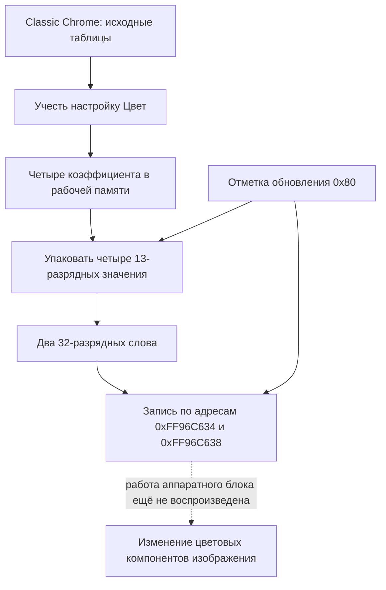

# Classic Chrome: как четыре числа доходят до адресов устройства

Проверка файла FWUP0028.DAT версии 5.30. Дата: 1 ноября 2026 года.

## Новый результат

Удалось продолжить прежнюю цепочку. Ранее были проверены выбор таблицы Classic Chrome, пересчёт четырёх коэффициентов при изменении «Цвет» и их перенос в общую запись параметров. Теперь найден и воспроизведён следующий участок: упаковка этих коэффициентов в рабочий образ регистров и две 32-разрядные записи по адресам **0xFF96C634** и **0xFF96C638**.

Исполнялись настоящие команды из предоставленной прошивки, без исправлений. Все рабочие буферы, входные условия и область устройства находились в виртуальной памяти на компьютере. Камера не использовалась. Поэтому проверка доказывает работу найденного программного пути; она не является чтением регистров настоящей X-H2 и не воспроизводит аппаратное вычисление цвета фотографии.

## Что происходит простыми словами

Представьте книгу с правилами работы и отдельными числовыми таблицами. При выборе «Цвет +2» камера не перепечатывает эту книгу. Она открывает другую строку таблицы, пересчитывает несколько чисел и составляет рабочее задание для обработчика изображения.

В найденной ветви можно различить пять действий:

1. **Выбрать исходные числа Classic Chrome.** В базовом образе настроек для этой ветви находятся 885, 859, −10 и −12. Это часть параметров обработки, а не четыре цвета и не готовый рецепт из меню.
2. **Учесть «Цвет».** В проверенном нейтральном окружении при 0 используется множитель 128, при +2 – 141. Получаются другие коэффициенты.
3. **Составить рабочую запись.** Четыре результата сохраняются в памяти. Рядом ставится отметка, что данную группу параметров нужно обновить.
4. **Упаковать результаты для устройства.** Каждый коэффициент занимает 13 значащих бит внутри 16-разрядного поля. Два таких поля помещаются в одно 32-разрядное слово.
5. **Выполнить запись по адресу устройства.** Таблица передачи указывает два адреса. Низкоуровневая команда записывает туда два подготовленных слова.

## Схема найденного пути



Сплошные стрелки показывают проверенные вычисления и перенос данных. Пунктир обозначает оставшуюся границу исследования. Схема относится к найденному пути передачи параметров и не устанавливает порядок всех операций от RAW до JPEG.

## Где именно меняются числа

В общей записи параметров есть вложенный раздел, начинающийся со смещения **+0x96C**. Ранее рассмотренные поля +0x1DA…+0x1E0 отсчитываются от начала этого вложенного раздела.

Например: **0x96C + 0x1DA = 0xB46**. Поэтому «поле +0x1DA» внутри раздела и «поле +0xB46» внутри общей записи – одно и то же место. Такая смена начала отсчёта затрудняла поиск следующей функции.

| Место внутри раздела | Место внутри общей записи | «Цвет 0» | «Цвет +2» | Место в подготовленном образе регистров |
|---|---|---:|---:|---|
| +0x1DA | +0xB46 | 885 | 974 | +0x1EC |
| +0x1DC | +0xB48 | −10 | −12 | +0x1EE |
| +0x1DE | +0xB4A | 859 | 946 | +0x1F0 |
| +0x1E0 | +0xB4C | −12 | −14 | +0x1F2 |

Здесь **смещение** – расстояние от начала записи в памяти. Оно не является ни значением цвета, ни прямым местом в исходном DAT. Названия «общая запись», «вложенный раздел» и «образ регистров» введены для объяснения их роли. Исходные имена структур разработчиков не восстановлены.

## Как выглядит реальная команда переноса

Функция упаковки начинается по адресу **0x013777D0**. Первая пара команд чтения и последующая запись относятся к первому коэффициенту:

```asm
013777EC  LDRSH w0, [x0, #0x1DA]
013777F0  BL    #0x01373E04
...
013777FC  BFXIL w0, w1, #0, #13
01377800  STRH  w0, [x19, #0x1EC]
```

Пояснение:

- `LDRSH` берёт 16-разрядное число из вложенного раздела и правильно восстанавливает его знак.
- Вызванная функция ограничивает число допустимым диапазоном для 13-разрядной записи.
- `BFXIL` заменяет младшие 13 бит выходного поля. Старшие три бита поля сохраняются.
- `STRH` записывает полученное 16-разрядное поле в образ регистров.

`x0`, `x19`, `w0` и `w1` – временные ячейки самого процессора. Их названия входят в обозначения машинных команд. Это не названия разделов прошивки и не специальные параметры Classic Chrome. В разных строках одна ячейка может уже содержать другое число или адрес.

Подготовленное поле ещё находится в рабочей памяти. Для записи в устройство нужен следующий этап.

## Как адреса выбираются из таблицы

Функция **0x01377884** передаёт общей функции записи **0x01373E84** адрес таблицы **0x018DF948** и количество записей – 2.

| Запись таблицы | Адрес назначения | Откуда взять слово в образе регистров | Количество 32-разрядных слов |
|---|---|---|---:|
| Первая | 0xFF96C634 | +0x1EC | 1 |
| Вторая | 0xFF96C638 | +0x1F0 | 1 |

Каждая запись таблицы занимает 24 байта. В ней находятся 64-разрядный адрес назначения, 64-разрядное смещение источника и 16-разрядное количество слов; оставшаяся часть данной записи не требуется для объяснения этой передачи.

По характеру таблицы и низкоуровневой записи это адреса регистров устройства, заданные программой. Официальные аппаратные названия этих регистров и документация их внутренних вычислений не получены.

Последнюю запись выполняет функция **0x0005DE10**:

```asm
0005DE10  STR w1, [x0]
0005DE14  RET
```

Здесь `x0` содержит адрес назначения, а `w1` – готовое 32-разрядное слово. Команда `STR` записывает слово по этому адресу. В выполненной проверке назначением служила виртуальная память с теми же адресами.

## Почему −12 превращается в 8180

В вычислениях используется число −12. Но в поле шириной 13 бит оно записывается по правилу дополнения до двух: **8192 − 12 = 8180**, или **0x1FF4**. Обратное прочтение такого поля с учётом знака даёт −12.

Это не дополнительное усиление цвета и не замена отрицательного коэффициента положительным. Меняется форма записи числа. Для сравнения, полный 16-разрядный вариант −12 выглядел бы как 0xFFF4; устройство получает только младшие 13 значащих бит, а оставшиеся три бита поля сохраняются отдельно.

При нулевых старших трёх битах получаются такие слова:

| Адрес назначения | «Цвет 0» | «Цвет +2» | Какие коэффициенты объединены |
|---|---|---|---|
| 0xFF96C634 | 0x1FF60375 | 0x1FF403CE | 885 и −10 → 974 и −12 |
| 0xFF96C638 | 0x1FF4035B | 0x1FF203B2 | 859 и −12 → 946 и −14 |

В шестнадцатеричной записи слово читается справа налево по значимости: например, у **0x1FF403CE** младшее поле **0x03CE** означает 974, следующее поле **0x1FF4** – коэффициент −12 в 13-разрядной форме. В памяти младший байт записывается первым.

Числа в таблице относятся к испытанию с нулевыми старшими битами полей. Если эти биты содержат другие значения, полное слово будет отличаться, хотя четыре коэффициента останутся теми же.

## Отметка обновления: зачем нужно 0x80

В сборщике параметров после подготовки этой группы выполняется операция «ИЛИ с 0x80» над полем **+0x178** исходного блока. Она устанавливает бит 7, не стирая остальные отметки.

Отдельно проверенные функции упаковки и передачи используют бит 7 входной маски для выбора группы четырёх коэффициентов. При установленном бите вызываются нужные обработчики. При нулевой маске две указанные записи не выполняются. Полное движение маски между всеми функциями реальной съёмки в этом опыте не воспроизводилось.

По смыслу это похоже на пометку «этот раздел задания требуется обновить». **0x80 не означает насыщенность 128**: совпадение численного значения с нейтральным множителем «Цвет» относится к двум разным назначениям числа.

## Точная карта проверенных функций

| Адрес | Проверенная роль |
|---|---|
| 0x02F1C7CC…0x02F1C7E0 | Фрагмент сборщика: подготовить четыре коэффициента во вложенном разделе и установить отметку 0x80 |
| 0x02F27054 | Подготовить и перенести коэффициенты в поля раздела +0x1DA…+0x1E0 |
| 0x02F1CDC8 | Передать адрес вложенного раздела общей записи и входную маску функции упаковки |
| 0x02D2F2EC | Выбрать обработчики упаковки по маске |
| 0x01377870 → 0x013777D0 | Упаковать четыре коэффициента в поля +0x1EC…+0x1F2 образа регистров |
| 0x01373E04 | Ограничить значение диапазоном указанной разрядности; здесь – 13 бит |
| 0x02F1CDF4 → 0x02D2F4F8 | Выбрать функции передачи по маске |
| 0x01377884 | Выбрать две записи таблицы 0x018DF948 |
| 0x01373E84 | Прочитать таблицу, взять слова из рабочего буфера и вызвать низкоуровневую запись |
| 0x0005DE10 | Записать 32-разрядное слово по переданному адресу |

## Что это говорит о лепестках розы

Теперь подтверждён ещё один переход между настройкой и обработчиком: пересчитанные числа доходят до адресов устройства, предусмотренных этой ветвью прошивки. При изменении «Цвет» программа отправляет другое задание.

Но запись 974 по одному из полей ещё не означает «красный лепесток стал на 10% насыщеннее». Коэффициент не является значением красного канала отдельного пикселя. Чтобы точно вычислить результат на фотографии, нужно восстановить аппаратную формулу применения этих полей, порядок относительно других цветовых и тональных операций и фактические условия обработки.

В прошивке также найден отдельный программный обработчик, использующий четыре коэффициента при смешивании двух компонентов, связанных с яркостью. Его связь с проверенным основным путём и условия включения требуют самостоятельной проверки. Результаты его предварительного просмотра не включены здесь в число установленных фактов о готовом JPEG.

## Как проверено и что осталось открытым

Выполнены **64 ограниченных запуска** исходных участков ARM64:

- 9 запусков подготовки – для «Цвет» от −4 до +4;
- 27 запусков упаковки – девять положений с тремя вариантами старших битов полей;
- 27 запусков передачи – проверены адреса, размер и точные значения обоих слов;
- 1 контрольный запуск с нулевой маской – записи двух коэффициентных слов отсутствуют.

Все запуски достигли ожидаемой границы исполнения. При передаче с маской 0x80 функция делает и другие служебные записи: в каждом испытании наблюдалось 27 записей в область устройства, из которых две относятся к рассматриваемым коэффициентам. Сама маска не означает «записать ровно два слова».

Старшие биты выходных полей действительно сохраняются. На входе использованы значения 0x0000, 0xA000 и 0xE000 для каждого поля. Контрольная сумма исходного DAT после анализа совпала с исходной:

`be47168cb075ef726e67cb4bb08175a896047a3b0de2bcb6e65333b22cfcb203`

Не проверены: работа физической камеры; обратное чтение аппаратных регистров; аппаратное преобразование пикселей; обязательное прохождение этой ветви при каждом режиме съёмки; полная связь всех событий меню, масок обновления и обработки кадра.

Материалы рядом с этим отчётом:

- [Программа воспроизведения](проверить_запись_коэффициентов.py).
- [Результаты 27 сочетаний и контрольного запуска](Проверка_записи_в_виртуальные_регистры.json).
- Реальные машинные команды проверенных участков *(файл не публикуется)*.

Повторная проверка из папки проекта:

```powershell
python -X utf8 'Анализ_прошивки\Связь_процессора_и_цвета\Продолжение_2026-11-01\проверить_запись_коэффициентов.py'
```

Следующий предметный шаг – установить формулу применения этих четырёх полей, сопоставив аппаратный путь с найденным программным обработчиком. Это приблизит исследование к расчёту цвета конкретного пикселя.
