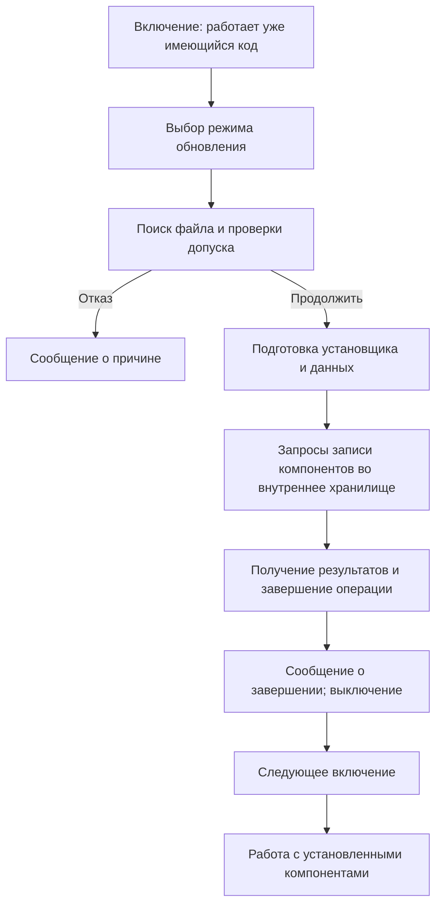

# Что происходит внутри X-H2 при установке прошивки

Разбор предоставленного FWUP0028.DAT версии 5.30. Дата: 1 ноября 2026 года.

## Как читать это объяснение

Ниже объединены три вида сведений:

- **Официальный порядок:** действия и ограничения из руководства Fujifilm.
- **Найдено в файле:** данные, строки, машинные команды и сценарии из предоставленного DAT.
- **Общая техническая логика:** объяснение работы памяти и установщика; точное исполнение каждого такого действия на физической X-H2 не наблюдалось.

Этапы показаны в логическом порядке. В действительной программе чтение, проверка, подготовка и запись могут быть разбиты на несколько проходов и частично совмещаться. Полная хронограмма установщика пока не восстановлена.

Мы исследуем программу версии 5.30, которая находится в пакете. Версия программы, уже установленной в конкретной камере владельца и запускающей обновление, в этой работе не считывалась.

## 1. Три места, которые участвуют в установке

| Место | Что в нём находится | Роль |
|---|---|---|
| Карта памяти | Файл FWUP0028.DAT | Источник новых программных компонентов и данных |
| Рабочая память камеры | Выполняемый код, временные буферы, параметры операций | Временное место для обработки запросов и прочитанных данных |
| Внутреннее постоянное хранилище | Установленные компоненты и сохраняемые данные | Место, из которого камера получает свою программу после отключения питания |

Рабочая память теряет обычное содержимое без питания. Постоянное хранилище сохраняет записанные данные. Файл на съёмной карте нужен для передачи обновления; дальнейшая работа камеры должна опираться на установленное содержимое внутри неё.


Эта схема объясняет места хранения. Она не означает, что весь DAT обязательно целиком загружается в рабочую память или что всё его содержимое сохраняется внутри камеры одним файлом.

## 2. После включения сначала работает уже имеющаяся программа

Процессору нужны команды, чтобы включить необходимые устройства, распознать органы управления и прочитать карту. Первые такие команды он получает из уже имеющейся системы запуска камеры.

Новая прошивка ещё находится на карте как данные. Сам факт наличия DAT не означает, что его команды уже выполняются.

Для X-H2 Fujifilm предусматривает вход в обновление при включении с удержанием DISP/BACK, а также через пункт обновления в настройках. Обычное включение и запуск установки – разные действия. [Руководство X-H2](https://fujifilm-dsc.com/en-int/manual/x-h2/technical_notes/firmware_version/).

Полное распределение обязанностей между начальной программой запуска и установленными компонентами X-H2 в нашем разборе не восстановлено. Нельзя пока указать, в какой именно момент установщик может передать управление отдельному модулю из нового пакета.

## 3. Камера переходит в отдельное состояние обновления

После выбора обновления программа должна организовать работу, отличающуюся от обычной съёмки: показать нужные сообщения, принять подтверждение и следить за результатом установки.

В предоставленном образе найдены обозначения:

```text
UI_MODE_UPDATE
A_UPDATE_INIT
A_UPDATE_START
A_UPDATE_WRITE
A_UPDATE_DEINIT
```

Найдены также диагностические строки `update_init()`, `update_start()`, `update_write()` и `update_deinit()` и использующие их функции. Это конкретные признаки отдельных программных этапов, а не наши условные названия.

Из этих обозначений ещё не следует, что на экране будут четыре отдельных полосы или что между этапами нет других действий. Они описывают организацию кода.

## 4. Найти файл и прочитать его служебные сведения

Чтобы получить данные с карты, камера обращается к её контроллеру и файловой системе. Программа ищет файл обновления с ожидаемым именем, открывает его и читает нужные сведения.

В нашем DAT подтверждены:

- размер 110 302 544 байта;
- поля версии, соответствующие 5.30;
- обозначение X-H2 в базовом образе настроек;
- сжатые области и другие программные компоненты;
- цифровая подпись в конце файла.

Программа установки должна различить подходящий пакет и файл, который нельзя использовать. В образе найдены ошибки `UI_ERR_UPDATE_NO_FILE`, `UI_ERR_UPDATE_BROKEN_FILE`, `UI_ERR_UPDATE_OLD_FILE` и `UI_ERR_UPDATE_MODEDIFFER`.

Официальный перечень Fujifilm также различает отсутствие файла, проблему чтения, неподходящую модель и версию, которая не новее установленной. [Сообщения об ошибках обновления](https://www.fujifilm-x.com/global/support/download/error-message/).

Точные поля, которые использует каждый обработчик совместимости, и полный порядок всех проверок ещё не прослежены. Само найденное внутри файла имя модели не доказывает, что камера проверяет совместимость простым поиском этой надписи.

## 5. Убедиться, что данные допустимы и не изменены

Проверку версии и модели нужно отличать от проверки целостности и подлинности. Файл может предназначаться нужной модели, но оказаться повреждённым при загрузке или копировании.

У данного файла **72 последних байта** составляют цифровую подпись ECDSA. На компьютере повторно проверено: подпись корректна для первых **110 302 472 байт**, с использованием SHA-256 и кривой secp256r1.

Понятная аналогия – заверенная книга. Содержание имеет свою математическую контрольную характеристику, а подпись связывает её с ключом издателя. Изменённый текст уже не соответствует прежней подписи.

Подпись не является командой «разрешить установку»: это данные, которые проверяющая программа использует в расчёте. Также она не является тем же самым, что инверсия битов и сжатие содержимого.

**Граница результата:** корректная подпись проверена нами на компьютере. Конкретная ветвь проверки подписи внутри камеры, её положение относительно остальных проверок и поведение каждой старой версии установщика пока не восстановлены. Поэтому нельзя выдавать «камера сначала читает весь файл, затем единственный раз проверяет подпись» за установленную последовательность X-H2.

## 6. Подготовить выполнение установки

После допуска пакета и подтверждения пользователя установщику требуется подготовить рабочие ресурсы: буферы, состояние операции, обработку сообщений и доступ к записываемому хранилищу.

При замене программных областей код, необходимый для самой записи, должен оставаться доступным процессору. В технических реализациях для этого используют рабочую память либо отдельную область, которую в данный момент не меняют. Как именно это организовано для всех компонентов X-H2, ещё не установлено.

Нельзя пока утверждать, что в X-H2 весь установщик работает только из оперативной памяти, что начальная программа запуска никогда не обновляется или что есть две полные копии прошивки с автоматическим возвратом к старой.

## 7. Передать запросы от экранного обработчика следующему программному уровню

Эту часть удалось проверить по настоящим командам.

| Этап | Функция экранного уровня, найденная по диагностике | Следующая функция | Код запроса | Размер дополнительных данных |
|---|---|---|---|---:|
| Подготовка INIT | 0x02A4EF80 | 0x02D3C76C | 0x600 | 16 байт |
| Запуск START | 0x02A4F0E0 | 0x02D3C7B0 | 0x602 | 4 байта |
| Запись WRITE | 0x02A4F170 | 0x02D3C7D8 | 0x603 | 4 байта |
| Завершение DEINIT | 0x02A4EED4 | 0x02D3C814 | 0x601 | 4 байта |

Вызовы этих функций найдены в коде. Подготовка четырёх запросов отдельно воспроизведена в виртуальной памяти с искусственными входными данными. Для WRITE и DEINIT выполнены фрагменты после предварительного служебного вызова. Реальная передача запроса и запись хранилища не запускались.

Пример для этапа WRITE:

```asm
02D3C7F0  LDR w0, [x19]
02D3C7F4  STR w0, [sp, #0x28]
02D3C7F8  ADD x2, sp, #0x28
02D3C7FC  MOV w1, #4
02D3C800  MOV w0, #0x603
02D3C804  BL  #0x02D3C724
```

Смысл: взять 4-байтовое значение, подготовить указатель на него, поставить размер 4 и код запроса 0x603, затем вызвать общую функцию оформления сообщения.

**Четыре байта здесь не являются размером всей прошивки или доказанным размером порции записи.** Это размер дополнительного поля конкретного запроса. Полный смысл этого поля ещё не расшифрован.

Следующая функция `0x02D3C724` формирует служебную запись: код запроса, другие признаки, длину дополнительных данных и указатель на них. Затем она вызывает функцию передачи `0x014CF124`.

Так видно разделение обязанностей: обработчик обновления формирует поручение; другой программный уровень должен его исполнить. Полный путь этого сообщения до контроллера постоянной памяти пока не восстановлен.

## 8. Прочитать и подготовить содержимое пакета

Обновление – уже собранный комплект. Камера не получает исходные файлы C и не компилирует их при установке. В нём лежат готовые команды, таблицы, ресурсы и системные компоненты.

Для анализа содержимое DAT восстанавливается инверсией битов, а некоторые области дополнительно распаковываются. Найдены четыре области FFLZ, а также сжатые данные Linux. Программа камеры должна использовать согласованные с этими форматами способы чтения и загрузки компонентов.

Однако из успешной распаковки на компьютере нельзя заключить, что камера распаковывает всё именно во время установки. Возможны разные обязанности:

- установщик записывает компонент в уже подготовленном виде;
- установщик сохраняет сжатый компонент, а распаковку делает программа следующего запуска;
- разные компоненты обрабатываются по-разному.

Точный вариант и порядок для каждой части этого пакета ещё не установлены.

Порции данных могут проходить через временный буфер. Это позволяет выполнять чтение и запись последовательно. Размер буферов и факт загрузки всего файла целиком нашим опытом не определены.

## 9. Записать изменения во внутреннее хранилище

Установщик передаёт устройству хранения данные и указания, куда их записать. Конкретные разделы, файлы и адреса зависят от устройства пакета и программы установки.

Здесь важно различать три вида адресов:

| Вид | Пример | Значение |
|---|---|---|
| Место в DAT | 0x00840274 | Где начинается сжатая область в установочном файле |
| Адрес в принятой карте рабочей памяти | 0x029AE000 | Где при разборе размещён соответствующий распакованный модуль |
| Место в постоянном хранилище | Полная карта пока не получена | Где компонент сохраняется внутри камеры |

Эти числа нельзя автоматически приравнять друг к другу. Адрес рабочей функции не показывает место её хранения во внутреннем накопителе.

В Linux-части найдены обращения к разделам `/dev/mmcblk0p1`, `/dev/mmcblk0p2`, `/dev/mmcblk0p3` и сценарии работы с eMMC. Это прямые программные признаки использования такого хранилища для части данных. Из них не следует, что абсолютно все компоненты прошивки находятся только на одном устройстве и заменяются одинаково.

На общем техническом уровне eMMC объединяет память NAND и контроллер. Программа обращается к логическим участкам, а контроллер организует физическую запись и управление блоками памяти. Поэтому программная запись и непосредственное изменение физических ячеек – разные уровни. Это описание технологии, а не установление производителя конкретной микросхемы X-H2. [Пояснение производителя eMMC](https://www.kingston.com/en/blog/embedded-and-industrial/emmc-lifecycle).

## 10. Конкретный пример из Linux: условное обновление области файлов

В настоящем сценарии `/usr/local/bin/emmc-update.sh` предусмотрена такая последовательность:

1. Проверить существование `/mnt/update/emmc_update.dat`.
2. При его наличии удалить прежнее содержимое `/mnt/usr`.
3. Развернуть туда содержимое указанного сжатого архива.
4. Удалить использованный временный архив.
5. Выполнить `sync`.
6. Сообщить `OK`; если архива нет – `NG`.

`sync` запрашивает завершение отложенной записи файловых данных. Его результат нужно отличать от одной лишь записи в временный буфер.

Это подлинная отдельная ветвь из прошивки. Её сценарий прочитан как текст и не выполнялся. Связь этой ветви с каждым штатным обновлением корпуса ещё не установлена.

В том же окружении есть отдельный сценарий начальной подготовки eMMC. Его наличие **не доказывает**, что камера форматирует весь внутренний накопитель при каждом обновлении. Нельзя объединять эти разные сценарии в обязательную последовательность без проверки вызывающего кода.

## 11. Получить итог записи и показать завершение

Программа должна получить результат операций: успешно ли завершилась передача и запись либо возникла ошибка. В образе найдены отдельные обозначения ошибок обновления и этап завершения DEINIT.

При установке часто используют дополнительные проверки записанного содержимого: чтение обратно, контрольные суммы и сравнение. Какие именно проверки, в каких местах и для каких компонентов использует X-H2, пока не установлено. Называть конкретный способ, например «побайтовое сравнение всего установленного образа», оснований нет.

Процент на экране – показатель программы обновления. Без расшифровки расчёта этого показателя нельзя считать его точной долей уже записанных байтов или оставшегося времени. Чтение, подготовка и запись могут занимать разное время.

Fujifilm предписывает не отключать питание и не управлять камерой во время обновления; после сообщения о завершении камеру следует выключить. Для X-H2 в руководстве указана возможная длительность до примерно 10 минут. [Руководство X-H2](https://fujifilm-dsc.com/en-int/manual/x-h2/technical_notes/firmware_version/).

Причина требования к питанию понятна из устройства операции: если часть постоянных данных уже заменена, а остальная ещё нет, может получиться неполный набор компонентов. Какие внутренние средства восстановления предусмотрены именно для каждой такой ситуации в X-H2, в этом разборе не установлено.

## 12. Следующий обычный запуск: начать пользоваться установленными компонентами

После завершения и следующего включения система запуска подготавливает нужные устройства и компоненты. Рабочая память получает необходимые программные части и данные из внутреннего хранения. Затем начинают работать системные задачи, меню и остальные части камеры.

Точный порядок запуска ThreadX, Linux и всех остальных модулей ещё исследуется. Уже найденные заголовки и команды показывают разные составляющие, но не заменяют полного наблюдения загрузки.

Основная перемена: теперь процессор получает команды и таблицы из установленного обновлённого набора. Сам процессор как физическая микросхема не заменяется.

Если конкретная версия меняет цветовую функцию или таблицу, это проявится при следующем её использовании. Установка не означает, что каждый цветовой коэффициент обязательно отличается от предыдущей версии: для такого вывода нужно сравнение обеих версий.

## 13. Настройки, пользовательские рецепты и калибровка

Программа, настройки пользователя и калибровочные данные имеют разные назначения. В DAT обнаружен базовый образ настроек, а в исследованных ветвях программа может обращаться к сохраняемым данным камеры.

Само присутствие базового образа не доказывает, что установщик безусловно заменяет им все индивидуальные настройки, серийные сведения и калибровку. Точный перечень сохраняемых, сбрасываемых или переводимых в новый формат данных при каждой версии обновления пока не восстановлен.

Поэтому нельзя обещать по одному разбору DAT, что любой набор C1–C7 всегда останется неизменным. Нужны указания к конкретной версии и, при исследовании кода, отдельный разбор ветви переноса настроек.

## Общая последовательность



Это логическая схема. Она не устанавливает точный порядок всех внутренних проверок, распаковок, записей и служебных отметок X-H2.

## Что проверено в этой работе

- Повторно проверена цифровая подпись исходного файла на компьютере.
- Подтверждены контрольные суммы двух использованных распакованных модулей.
- Найдены обозначения этапов и ошибок обновления.
- Установлена связь четырёх обработчиков с функциями подготовки запросов.
- В четырёх ограниченных запусках проверены коды, длины и дополнительные данные запросов.
- Прочитаны два сценария Linux, относящиеся к обновлению eMMC и сведениям о его версии.
- Сценарии, передача сообщений и запись устройств не выполнялись.
- SHA-256 исходного DAT до и после анализа совпал:

`be47168cb075ef726e67cb4bb08175a896047a3b0de2bcb6e65333b22cfcb203`

Материалы:

- [Результаты проверки](Проверка_этапов_обновления.json).
- Машинные команды обработчиков и запросов *(файл не публикуется)*.
- [Программа повторной проверки](проверить_этапы_обновления.py).

Официальный порядок действий: [Fujifilm, обновление камер X](https://www.fujifilm-x.com/global/support/download/procedure-x-interchangeable-ver2/).
