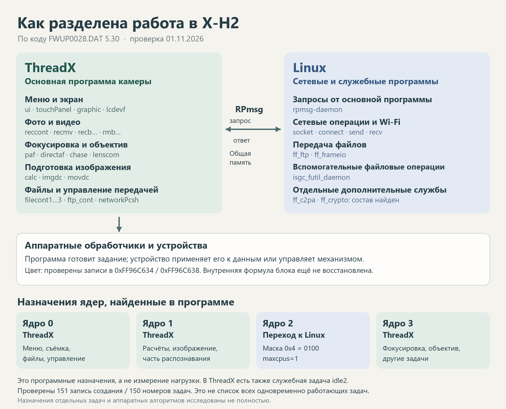

# Две операционные системы в одной камере

На форумах иногда пишут, что «внутри Fujifilm Linux». Это правда, но неполная. В прошивке X-H2 5.30 нашлись две операционные системы, и главная из них не Linux.

## Кто главный

Основной программой камеры управляет **ThreadX** версии G5.9.5.5. Это маленькая система реального времени для устройств, где важно реагировать за доли секунды. Она раздаёт процессорное время «задачам». Задача здесь — постоянно работающий кусок программы со своей ролью: одна слушает кнопки, другая организует запись, третья занимается фокусировкой. Большую часть времени задача ждёт поручения, выполняет его и снова засыпает.

**Linux** версии 4.9.92 запускается отдельно и занимается в основном связью: сеть, Wi-Fi, передача файлов. В его файловой системе есть программы с говорящими именами `ff_ftp.exe`, `ff_frameio.exe`, `ff_c2pa.exe` и `rpmsg-daemon`. Между двумя системами есть канал сообщений RPmsg: основная программа передаёт Linux поручения, Linux отвечает.

Фраза «в камере используется Linux» подтверждается. Фраза «вся камера работает на Linux» описывает находку слишком широко.

## Кто чем занят

Имена задач прошивка хранит открытым текстом, а команды их регистрации в ThreadX удалось найти и проверить. Для X-H2 подготовлена 151 запись регистрации.

| Область | Задачи | Что известно |
|---|---|---|
| Меню и управление | `ui`, `syscont`, `touchPanel`, `keytimer` | Регистрация в ThreadX подтверждена |
| Экран и видоискатель | `graphic`, `lcdevf`, `dotlcd` | Управление выводом изображения |
| Фотосъёмка | `reccont` и 17 задач `recb…`, в том числе `recbjpeg`, `recblsraw` | Найдена общая таблица создания группы |
| Видеосъёмка | `recmv` и 21 задача `rmb…`, в том числе `rmbEnc` | Этапы видеозаписи |
| Фокусировка | `paf`, `directaf`, `tracking`, `chase`, `paf_sub0`, `paf_sub1` | Регистрация доказана, формулы неизвестны |
| Объектив | `lenscom`, `lensdata`, `lswatch` | Протокол команд не разобран |
| Распознавание объектов | `face`, `eye`, `subjdc`, `aiproc` | Точки входа известны, нейросети не прослежены |

Задача с именем `h265` или `recbdsp` не означает, что сжатие видео считает обычный процессор. Тяжёлую работу выполняют специализированные блоки, а задача им поручает и забирает результат. Примерно как начальник цеха: станки крутит не он, но без него станки стоят.

## Железо, на котором всё это работает

Fujifilm называет процессор камеры X-Processor 5. В описании оборудования внутри прошивки нашлось больше подробностей:

- четыре записи `arm,cortex-a53` — тип вычислительных ядер;
- строка `model = "Socionext MARBLE Development Board"` — судя по всему, описание досталось от отладочной платы производителя микросхем;
- упоминания CEVA-XM6, специализированного ядра для обработки изображений и машинного зрения.

Плату MARBLE внутри камеры никто не нашёл бы: это след того, откуда взяли программное описание. Название изделия и тип вычислительного ядра — разные уровни описания, их легко спутать.

## Чего мы пока не знаем

Полный список задач, которые работают одновременно в момент съёмки, не составлен. Как именно кадр проходит от матрицы до файла, на уровне задач тоже не прослежено. Регистрация задачи доказывает, что задача существует, но не доказывает, что она участвует в каждом снимке.

**Полные отчёты:** [распределение обязанностей ThreadX и Linux](../полные_отчёты/Распределение_систем_2026-11-01/Распределение_обязанностей_ThreadX_Linux_XH2.md), [главные блоки](../полные_отчёты/Архитектура_2026-11-01/Главные_блоки_и_устройство_кода_XH2.md).
